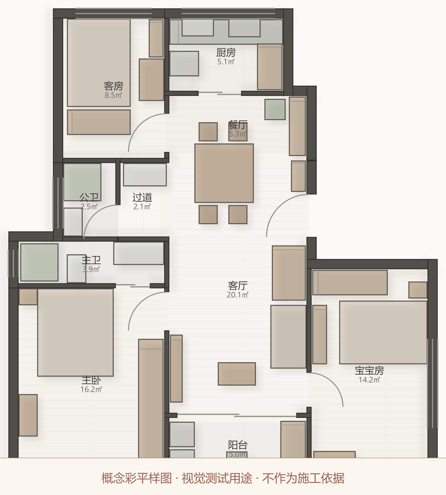

# CAD Visual Preview

**概念彩平视觉测试样图** — 用于设计表现风格的视觉评审。

历史版本：[preview.png](preview.png)（首个概念样图）

## 这是什么

一张住宅平面布置图的**彩色表现稿（彩平图）**，用于向客户/评审者展示空间关系、
地面材质与配色方案。采用低饱和暖灰色调。

- **户型**：117㎡ 三居（练习题／教学用图纸，非真实客户项目）
- **内容**：房间分隔、户型面积、地面材质（木地板／瓷砖／石材）、家具布置、柔和阴影
- **生成方式**：由 CAD 矢量数据程序化渲染（非 AI 图像生成，图形位置与原始图纸一致）
- **本版更新（v1.1-P0）**：修复渲染链路缺陷，40 件家具全部正确呈现

## ⚠️ 重要声明

**本图仅为设计表现与视觉测试用途，不作为施工依据。**

- 图示尺寸、构件位置不代表最终施工图
- 家具体块为简化表示，非实际产品尺寸（模型不含家具旋转数据）
- 不可用于施工、报价、拆单或任何工程用途

## 授权

本图片由作者生成并发布，供视觉评审使用。
